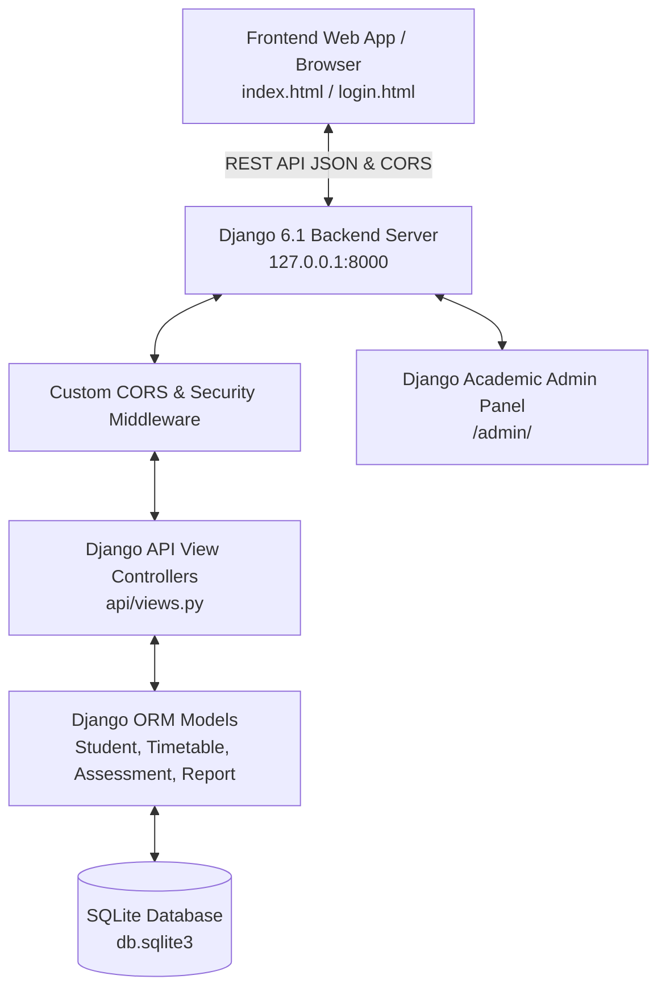

# 🐍 Student Interest Portfolio - Python Django Backend Guide
**5th-Semester Computer Science & Engineering Mini Project**

---

## 📌 Architecture Overview

The backend is built with **Python 3.15 & Django 6.1**, providing a relational **SQLite** database and RESTful JSON API endpoints to manage student accounts, weekly schedules, 10-question interest assessments, and dynamic academic report calculations.



---

## 🚀 How to Run the Backend

### Method 1: 1-Click Launch (Easiest)
Simply double-click **`run_backend.bat`** in the project root folder.  
It will automatically:
1. Verify database migrations (`python manage.py migrate`)
2. Start the development server at **`http://127.0.0.1:8000/`**

### Method 2: Command Line (PowerShell / Terminal)
```bash
cd backend
python manage.py runserver 127.0.0.1:8000
```

---

## 🔐 Django Admin Portal

A full academic administration dashboard is available to inspect, edit, and audit database tables:
- **URL**: [http://127.0.0.1:8000/admin/](http://127.0.0.1:8000/admin/)
- **Username**: `admin`
- **Password**: `admin123`

In the Admin panel, faculty or examiners can:
1. View, filter, and search registered students by USN, branch, and semester.
2. Inspect individual Monday-to-Sunday weekly timetable matrices.
3. Review 10-question diagnostic scores, percentages, and dimension ratings.
4. Access archived student portfolio reports.

---

## 👥 Pre-Configured Demo Accounts (Ready for Viva)

| Student Name | USN / Student ID | Branch | Focus Areas | Password |
|---|---|---|---|---|
| **Sahana K.** | `1MS22CS095` | Computer Science & Eng. | C Programming & Web Development | `student123` |
| **Rahul Sharma** | `1MS22CS080` | AI & Machine Learning | AI / ML & Python | `student123` |
| **Priya Patel** | `1MS22CS102` | Information Science & Eng. | Cybersecurity & Systems | `student123` |

To re-seed or reset default data at any time:
```bash
cd backend
python manage.py seed_data
```

---

## 🌐 Complete REST API Endpoint Reference

All endpoints return JSON responses.

### 1. Health & Developer Dashboard
| Method | Endpoint | Description |
|---|---|---|
| `GET` | `/` | Interactive Visual Developer API Dashboard |
| `GET` | `/api/health/` | Server health, database status, and total record counts |

#### Health Check Example (`GET /api/health/`)
```json
{
  "status": "healthy",
  "service": "Student Interest Portfolio Report Generator API",
  "framework": "Python / Django 6.1",
  "database": "SQLite3 (Active)",
  "metrics": {
    "studentsCount": 3,
    "timetablesCount": 3,
    "assessmentsCount": 14,
    "savedReportsCount": 0
  }
}
```

---

### 2. Authentication & Accounts
| Method | Endpoint | Description |
|---|---|---|
| `POST` | `/api/auth/login/` | Authenticate student via USN & password |
| `POST` | `/api/auth/register/` | Register new student & initialize timetable |
| `GET` | `/api/auth/demo-users/` | Get list of demo student accounts |

#### Login Request (`POST /api/auth/login/`)
```json
{
  "studentId": "1MS22CS095",
  "password": "student123"
}
```

---

### 3. Student Particulars
| Method | Endpoint | Description |
|---|---|---|
| `GET` | `/api/students/<usn>/` | Retrieve student profile particulars |
| `PUT` | `/api/students/<usn>/` | Update student profile particulars |

---

### 4. Weekly Timetable
| Method | Endpoint | Description |
|---|---|---|
| `GET` | `/api/timetable/<usn>/` | Retrieve student's Monday-to-Sunday hourly routine |
| `PUT` | `/api/timetable/<usn>/` | Update student's weekly schedule matrix |
| `POST` | `/api/timetable/<usn>/reset/` | Reset student's schedule to demo timetable |

---

### 5. Subject Interest Assessments
| Method | Endpoint | Description |
|---|---|---|
| `GET` | `/api/assessments/<usn>/` | Retrieve all subject assessments & scores |
| `POST` | `/api/assessments/<usn>/` | Save/update a diagnostic 10-Q assessment |
| `POST` | `/api/assessments/<usn>/auto-assess/` | Auto-populate realistic scores for all 14 subjects |

---

### 6. Portfolio Reports & Analytics Engine
| Method | Endpoint | Description |
|---|---|---|
| `GET` | `/api/reports/<usn>/` | Dynamically calculate hours, percentages, and AI insights |
| `POST` | `/api/reports/<usn>/save/` | Archive an academic report in the database |
| `GET` | `/api/reports/<usn>/history/` | Retrieve past archived evaluation reports |

---

## 💡 Key College Project Defense & Viva Talking Points

1. **Model-View-Controller (MVC / MVT) Architecture**:
   - **Models** (`backend/api/models.py`): Explicit schemas for students, schedules, assessments, and reports with relational constraints and cascade deletions.
   - **Views** (`backend/api/views.py`): Clean REST API endpoints with status codes (200, 201, 400, 401, 404).
   - **Templates / Admin** (`backend/api/admin.py`): Built-in Django ORM Admin portal for institutional auditing.

2. **CORS Handling Without External Dependencies**:
   - Custom `CustomCorsMiddleware` sets `Access-Control-Allow-Origin`, handles preflight `OPTIONS` requests, avoiding dependency headaches.

3. **Hybrid Resilience (Offline-First Fallback)**:
   - The frontend detects whether the Django server is online. If online, it synchronizes all data with the SQLite database. If offline, it smoothly uses browser `localStorage`. Your viva demo will **never fail** even without internet or if the server is paused!
