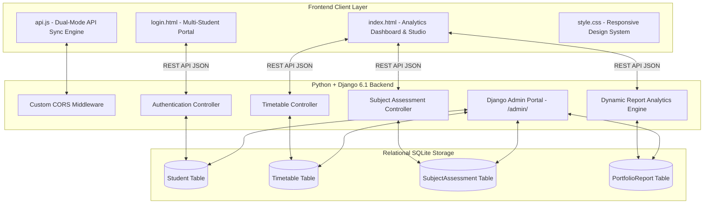
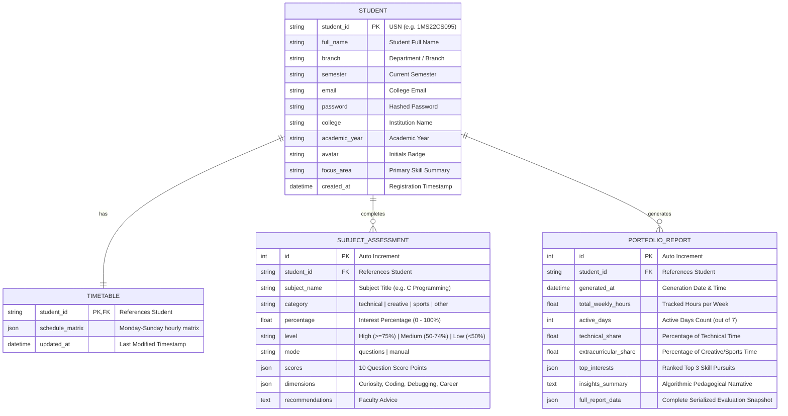

# 🎓 Student Interest Portfolio Report Generator
## 5th-Semester Computer Science & Engineering Mini Project Documentation

---

## 📋 1. Project Abstract
The **Student Interest Portfolio Report Generator** is a full-stack academic analytical system designed to track, evaluate, and categorize a student's weekly time expenditure across technical coursework, creative pursuits, sports, and extracurricular activities. By analyzing an hourly **Monday-to-Sunday weekly routine** alongside **domain-specific 10-question diagnostic assessments**, the system dynamically computes interest percentages, prioritizes skill areas, identifies the student's Top 3 pursuits, synthesizes algorithmic natural language insights, and generates official institution-formatted academic evaluation reports ready for Head of Department (HOD) and faculty advisor endorsement.

---

## 🎯 2. Objectives & Scope
- **Time Expenditure Mapping**: Provide a dynamic hourly routine grid (Monday–Sunday) tracking subjects and commitments.
- **Diagnostic Interest Modeling**: Offer 10-question weighted response diagnostic tests across 14 computer science and extracurricular domains.
- **Data Isolation**: Support individual authentication and isolated storage where each student's routine and calculations are kept independent.
- **Dual-Mode Persistence Architecture**: Provide a robust **Python 3.15 + Django 6.1** backend with relational **SQLite** persistence, paired with seamless offline fallback to browser **LocalStorage**.
- **Institutional Reporting**: Output print-ready A4 academic portfolio documents with student declarations, faculty endorsements, and departmental approval seals.

---

## 🏗️ 3. System Architecture

---

## 🗄️ 4. Database Schema (Entity-Relationship)

---

## 📊 5. Core Modules & Implementation Details

### Module 1: Multi-Student Authentication & Isolation
- **Location**: `login.html`, `auth.js`, `backend/api/views.py` (`auth_login`, `auth_register`, `auth_demo_users`)
- **Features**:
  - Secure sign-in using registered Student ID (USN) and password.
  - 1-Click quick account switcher for pre-configured student accounts:
    - **Sahana K.** (`1MS22CS095` / `student123`) &bull; CSE
    - **Rahul Sharma** (`1MS22CS080` / `student123`) &bull; AIML
    - **Priya Patel** (`1MS22CS102` / `student123`) &bull; ISE
  - Complete data isolation per USN in both SQLite database and browser localStorage.

### Module 2: Weekly Routine Timetable Studio
- **Location**: `index.html` (Timetable Tab), `app.js`, `backend/api/views.py` (`timetable_detail`, `timetable_reset`)
- **Features**:
  - Interactive matrix across 7 days (Monday through Sunday) and hourly time slots (8:00 AM – 7:00 PM).
  - 1-Click cell assignment, subject clearing, and schedule reset.
  - Direct integration linking any scheduled cell to its corresponding diagnostic questions.

### Module 3: 10-Question Diagnostic Assessment Studio
- **Location**: `index.html` (Analysis Tab), `app.js`, `backend/api/views.py` (`assessments_collection`, `assessments_auto_fill`)
- **Features**:
  - Covers 14 domains (C Programming, Web Dev, Python, AI/ML, Cybersecurity, DSA, DBMS, Computer Networks, Operating Systems, UI/UX, Cloud, Mobile App, Music, Sports).
  - 5-point weighted rating scale ($0.0$ to $10.0$ points per question).
  - Real-time mathematical calculation:
    $$\text{Interest \%} = \sum_{i=1}^{10} \text{Points}_i$$
  - Four dimensional breakdown: **Conceptual Curiosity**, **Hands-on Coding**, **Debugging Drive**, and **Career Alignment**.
  - Manual slider override mode allowing percentage adjustment with bi-directional synchronization.

### Module 4: Algorithmic Insights & Report Generation Engine
- **Location**: `index.html` (Report Tab), `app.js`, `backend/api/views.py` (`report_analytics`, `report_save`)
- **Features**:
  - Dynamic computation of weekly hours, consistency ratio ($n/7$ days), technical vs extracurricular ratio.
  - Ranking algorithm identifying Primary (Gold), Secondary (Silver), and Tertiary (Bronze) pursuits.
  - Pedagogical natural-language assessment narrative generation.
  - Print-ready `@media print` layout with student declaration, faculty endorsement, and HOD approval blocks.

### Module 5: Django Administration & Auditing Portal
- **Location**: `backend/api/admin.py` (`http://127.0.0.1:8000/admin/`)
- **Features**:
  - Full institutional oversight enabling faculty to view all registered students, query timetables, review individual assessment scores, and export report histories.

---

## 💡 6. Viva Voce Cheat-Sheet (Questions & Answers)

**Q1: Why did you choose Python with Django for the backend?**  
*Answer*: Django provides a robust, enterprise-grade Model-View-Controller (MVT) architecture with an Object-Relational Mapper (ORM), built-in administrative dashboard, and native SQLite support that requires no external database server installation.

**Q2: How does the application ensure student data isolation?**  
*Answer*: Every record in the `Timetable`, `SubjectAssessment`, and `PortfolioReport` tables is bound via a foreign key relation to the student's unique University Seat Number (USN). In client-side storage, keys are strictly namespaced by USN (`sip_timetable_<USN>`, `sip_subject_assessments_<USN>`).

**Q3: What happens if the backend server is stopped during evaluation?**  
*Answer*: The system incorporates a hybrid offline-first fallback in `api.js`. If the Django REST API is unreachable, the application automatically falls back to browser localStorage. The user interface displays a status badge indicating whether it is in `🟢 Django API Online` or `🟠 LocalStorage Mode`.

**Q4: How did you handle Cross-Origin Resource Sharing (CORS)?**  
*Answer*: We implemented a custom `CustomCorsMiddleware` in `backend/sip_backend/middleware.py` that intercepts incoming HTTP requests, handles `OPTIONS` preflight requests, and appends `Access-Control-Allow-Origin: *` headers without relying on external third-party dependencies.

**Q5: Can the application be accessed on mobile devices?**  
*Answer*: Yes. The Django server binds to `0.0.0.0:8000`, allowing any device connected to the same Wi-Fi or mobile hotspot to open the complete application and admin portal via the host machine's IP address (e.g. `http://192.168.x.x:8000/`).
